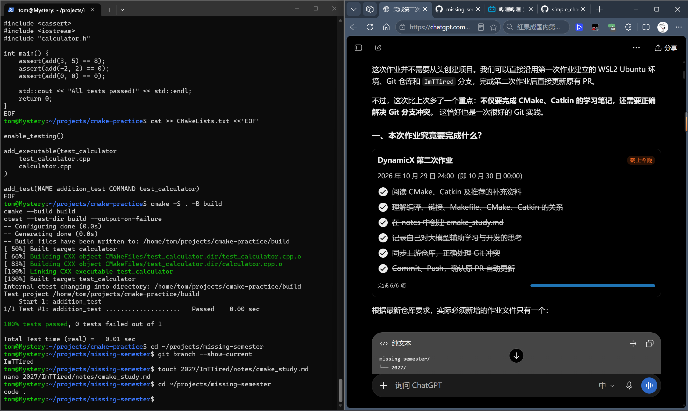
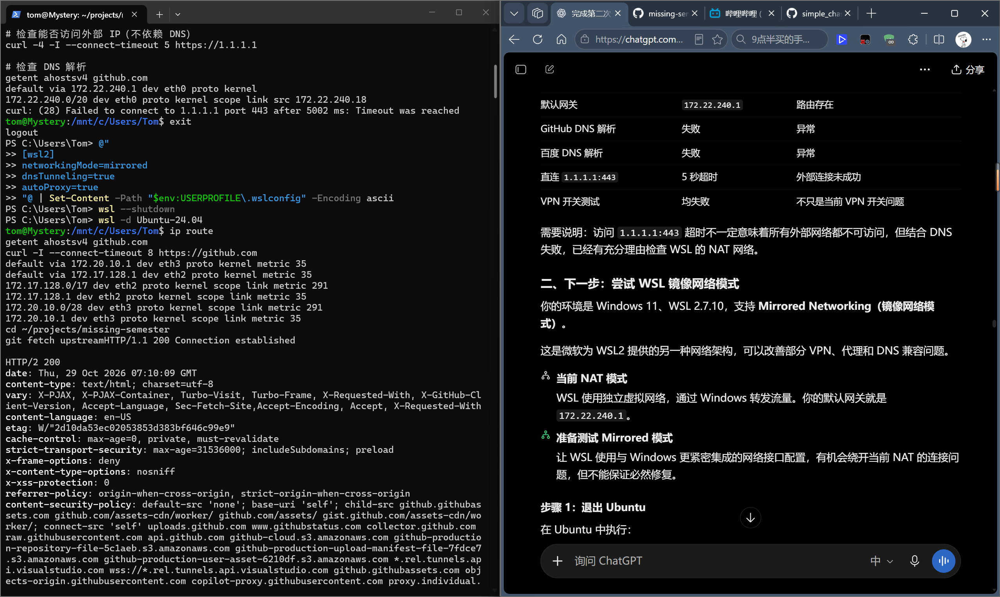
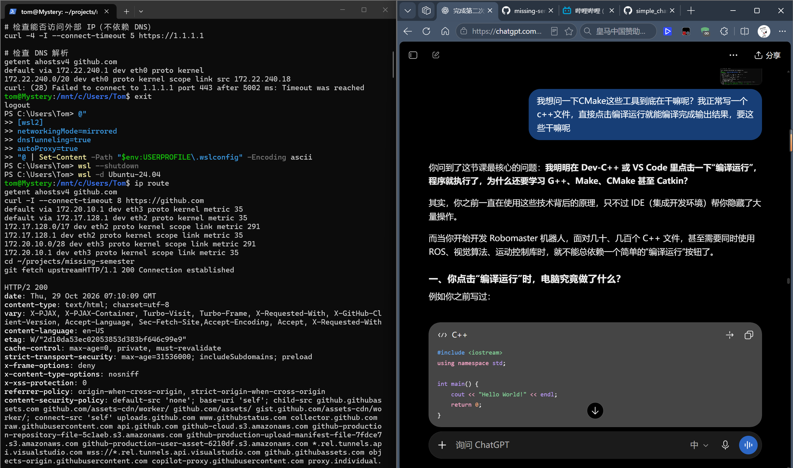
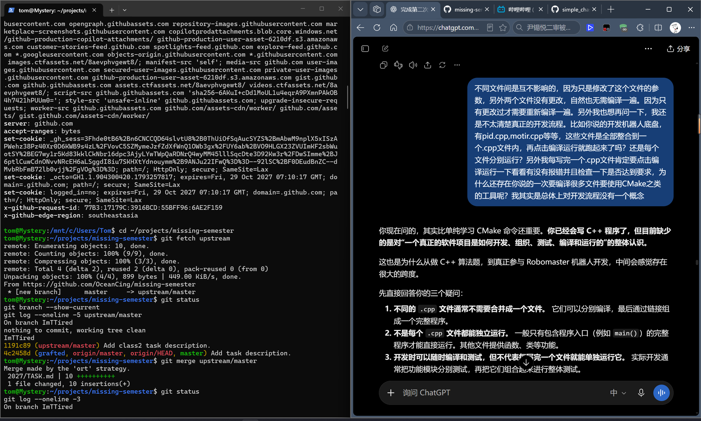
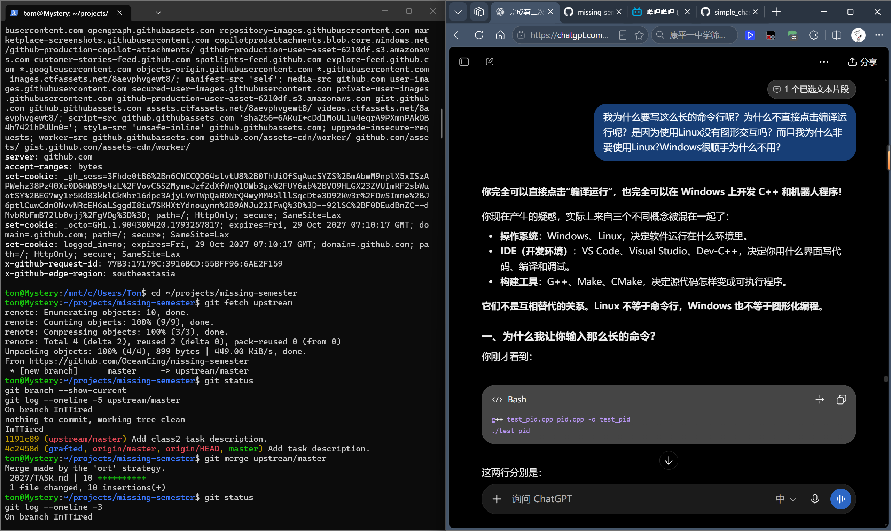

# DynamicX 第二课学习记录：CMake、Catkin 与 AI 辅助开发

**完成时间：** 2026.10.29
**学习环境：** Windows 11、WSL2 Ubuntu 24.04、VS Code

**完成人：** 王子豪 （ImTTired）


### 首先先抱歉第二次作业延期这么久:

这次在 WSL 网络配置和 CMake 实际操作上花了不少时间，不过也确实学到了很多东西，感谢学长理解！最近这一周确实比较繁忙，一周三天满课，两天三节课，广交会志愿者的培训以及繁琐的学校事务…（但是加入DX确实是我的第一要务）

**真的不好意思啦延期这么久~**


---

## 先总结一这节课的主要内容：
    首先讲从源代码到可执行程序的四个步骤，依靠手动编译极其繁琐，所以引入了Makefile这个工具（一份自动编译的说明书）。但是文件越来越多，要手动改动的地方也越来越多，单纯手写Makefile也越来越不方便。所以有了Cmake（Makefile生成器），并且通过写CMake配置工具，还能解决不同系统间的兼容问题。课程演示了CMake的便捷性。

    接下来讲解catkin，作为ros官方的指定系统，以及其package和大致使用方法。接着讲了大模型的使用。（诶 这个方面我熟悉啊，从初三就开始使用GPT3.5，真是完整感受到了AI进化的完整命脉，使用方法我也熟悉）主要强调了六点使用方法、skill、agent.m、各种agent软件等等，最后重点强调了要负责任使用AI，对团队负责，对自己负责。

### 我听完线下课又听了一遍线上课，但是教学内容依然很快，所以我使用和GPT对话来强化学习。以下是我让AI总结的我们今天解决的问题，我提出的问题与得到的收获，真实的CMake实践，以及我是如何与AI协同工作的（内容完全真实，因为在ppt和GitHub上有明确指出不应由AI直接生成文档，所以AI从一开始就完全执行了这条规定，并且无法修改）


 

 




*以下AI生成（绝对真实）:*


## 今日完成任务总结：

## 一、开发环境配置与问题排查

今天首先遇到的问题是 WSL2 Ubuntu 无法正常访问 GitHub，执行 `git fetch upstream` 时出现 `Could not resolve host: github.com`。起初怀疑是 VPN 和 DNS 配置问题，于是在 AI 的指导下，先后检查了 Windows 与 WSL 的 DNS 解析、代理环境变量、网络路由以及 WSL 配置，并尝试关闭 VPN、重启 WSL、启用 DNS Tunneling 等方案，但均未成功。

进一步测试发现，Windows 能正常解析域名，Ubuntu 却无法解析，而且直接访问外部 IP 也出现超时。这让我们意识到，问题可能不只是 DNS，而是 WSL 虚拟网络本身的连接问题。

最终，我们将 WSL2 的网络模式从 NAT 切换为 Mirrored（镜像网络模式），重新启动后成功恢复了 GitHub 的 HTTPS 访问，`git fetch upstream` 也终于执行成功。

这次排查让我第一次比较系统地接触了网络解析、代理、虚拟网络模式和 Linux 网络诊断。相比以前遇到问题就重启软件或直接搜索解决方案，这次更重要的收获是学会**通过测试结果逐步缩小故障范围，而不是盲目修改配置**。

网络恢复后，我继续在原有的 `ImTTired` 分支上合并上游仓库更新。虽然负责人提醒本次作业可能出现 Merge Conflict，但实际操作中 Git 自动完成了合并，并保留了第一次作业的内容。过程中还第一次接触了 Git 自动打开 Nano 编辑器填写 Merge Commit 信息的操作。

## 二、CMake 实际构建与测试

完成 Git 同步后，我们开始配置 C++ 开发环境。最初 Ubuntu 中尚未安装 G++、Make 和 CMake，于是使用 `apt` 安装了 `build-essential` 和 `cmake`，并验证了工具版本：

- G++ 13.3.0
- GNU Make 4.3
- CMake 3.28.3

随后在 `~/projects/cmake-practice` 中实际创建了一个简单的多文件 C++ 计算器项目，由 `main.cpp`、`calculator.cpp` 和 `calculator.h` 组成。

首先使用 G++ 手动编译和链接，成功得到 `3 + 5 = 8`。随后编写 `CMakeLists.txt`，使用 CMake 生成构建文件并完成编译，得到了相同的运行结果。

在此基础上，我们进一步增加了 `test_calculator.cpp`，通过断言验证多个输入，并在 CMake 中使用 `enable_testing()` 和 `add_test()` 注册测试。最终通过 CTest 自动执行测试，得到了：

```text
1/1 Test #1: addition_test ... Passed
100% tests passed, 0 tests failed out of 1
```

这是我第一次实际使用 CMake 管理多个构建目标，并使用 CTest 进行自动化测试，而不只是阅读 PPT 中的概念。

实际操作也让我注意到，同一个 `calculator.cpp` 可以被主程序和测试程序分别使用。后续还可以进一步尝试 `add_library()`，将公共功能模块构建为库，供多个目标复用。

Catkin 部分目前主要学习了 ROS 1 工作空间和 Package 的组织方式。由于我的环境是 Ubuntu 24.04，没有直接安装已结束官方支持的 ROS 1 Noetic，因此暂未实际创建 Catkin 工作空间。这部分计划在后续合适的环境中继续实践。

## 三、从个人疑问到对实际开发流程的理解

这次学习中，我最困惑的并不是某一条 CMake 命令，而是：**既然以前写 C++ 只需要点击“编译运行”，为什么真正开发时还需要这些复杂的工具？**

围绕这个问题，我向 AI 连续提出了几个疑问：

- 多个 `.cpp` 文件究竟是分别运行，还是整合到一个文件中运行？
- 既然开发过程中每完成一个模块都会测试，为什么还需要统一构建？
- 为什么不直接使用熟悉的 Windows 和 VS Code，而要在 Linux 终端中操作？

经过交流，我逐渐意识到，以前主要是在写独立的小程序，而实际的机器人开发需要将不同功能拆分为模块，通过接口协作，再进行编译、链接和集成测试。

例如，一个底盘控制项目可以分别包含 PID、电机控制、底盘运动学等模块。它们不需要合并进同一个源文件，而是分别开发和测试，最终组成完整程序。某个模块单独测试通过，也不能保证它与其他模块配合时不会出现问题。

我还修正了一个原本的理解：最开始我认为只有修改过的 `.cpp` 文件才需要重新编译，后来了解到，**真正需要关注的是文件之间的依赖关系**。例如修改公共头文件，就可能影响多个源文件的重新编译。

同时，我也认识到 Linux 和图形化开发并不矛盾。完全可以在 Windows 上使用 VS Code 编辑代码，通过 WSL2 提供 Linux 构建环境。命令行是理解和控制开发过程的一种方式，并不是必须放弃图形化 IDE。

这些问题的讨论让我开始从“怎样写对一段 C++ 代码”，转向思考“怎样组织、构建、测试并维护一个完整的软件项目”。

## 四、对大模型辅助学习与开发的思考

其实在这次培训之前，我就已经长期将 AI 用于学习、项目开发和问题排查。之前的 MeArm 机械臂控制项目、使用 Codex 开发自动化工具，以及 Git、Linux 的学习，都让我逐渐形成了一种学习方式：**由自己提出目标和问题，让 AI 协助探索方案，再通过实际操作验证结果。**

今天的经历进一步强化了这种认识。

一开始，AI 告诉我 CMake 可以管理大型工程，但我并没有真正理解它的必要性。于是我继续追问 IDE 为什么不能直接解决、多文件程序如何协作、每个模块如何测试等问题。随着问题逐步深入，AI 不再只是解释单个知识点，而是结合机器人底盘开发的例子，帮助我建立起软件工程开发流程的整体认识。

在解决 WSL 网络问题时，AI 也不是一次就给出了正确答案。我们先后尝试了多种方案，有些并没有成功，但每次终端输出都提供了新的信息，最终才通过切换网络模式解决故障。这让我意识到，**AI 的价值不仅在于快速给出答案，更在于帮助分析问题、设计验证方法，并根据反馈调整思路**。

我认为 AI 辅助学习与直接让 AI 完成任务之间最大的区别，在于自己是否参与了理解、判断和验证。如果只是复制代码或命令，即使任务成功，也可能不知道程序为什么能运行、问题为什么被解决。

相反，如果把 AI 当作一个可以不断追问的导师，并结合真实项目进行实践，就能够从具体问题延伸到更系统的知识。这种交互式学习方式尤其适合编程与工程开发。

但 AI 也可能给出不完全适合当前环境的建议，因此仍需要结合终端反馈、官方文档和实际测试进行判断。**我希望逐渐从依靠 AI 告诉我每一步怎么做，转向能够独立分析问题，再利用 AI 提高解决问题的效率。**

## 五、后续学习方向

这次已经实际完成 CMake 多文件构建和 CTest 测试，但目前还只是一个非常小的入门项目。接下来希望继续学习库的组织与链接、较复杂工程中的依赖管理，并将这些知识应用到实际机器人控制项目中。

Catkin 方面则计划继续了解 ROS Package 的依赖关系，以及 ROS 1 的 Catkin 与 ROS 2 的 Ament、Colcon 构建体系之间的区别。

**本次最大的收获，是不再只把 CMake 看成需要背诵命令的工具，而是开始理解它在整个软件开发工作流中的位置。**

---

## 参考资料

- [ROS Catkin Tutorials](https://wiki.ros.org/catkin/Tutorials)
- [CMake 基础教程——菜鸟教程](https://www.runoob.com/cmake/cmake-basic.html)
- [知乎补充资料](https://zhuanlan.zhihu.com/p/476697014)
- [The Emperor Has No Clothes](https://www.mihaileric.com/The-Emperor-Has-No-Clothes/)
- DynamicX 第二课 PPT：《CMake 与 Catkin 基础、大模型使用入门》

---

*以下我手写的：*

# 我的感悟：

这次读了扩展文档和与AI对话学习，我是真明白了机器人这类大型项目的开发流程。原来我总在想，每次编写一个cpp文件后肯定要自己编译运行一下看看有没有bug，那为什么还要用这些CMake之类的工具甚至用命令行来控制，这很麻烦。后来我明白了，有些程序就是个子函数，一个工程一般都是一个主程序，多个子函数写进多个cpp里，这样要跑起来的时候，几十上百个程序就很麻烦了。而且CMake还能理清各个程序间的关系，这是很重要的。


## 下面我说说我对大模型帮助学习的想法：
  我从初三开始就在探索使用大模型来辅助学习，我觉得最妙的就是在提问前先告诉它我的基本情况，例如准备学习什么，目前什么基础，哪里特别迷糊，以及让他从这个知识点的源头（为什么产生）来串联讲起，最后能大彻大悟，仿佛我亲自发明并完善了这个知识一样。并且哪里不懂的话我会左键选择这段话，然后在菜单栏里面点击询问ChatGPT，就能精准获得答案。

---


  另外在完成大的任务前（比如这次作业），我会先把所有信息整合并用具体语言告诉他目的，它不清楚的地方向我提问。当一切明白后，我会让它给我梳理一下这个任务，这样各种时间节点就不会忘记或者漏看，并且他会教我用最好的流程来完成任务。最棒的是，按照他的步骤来完成任务时，哪里出现问题，可以随时询问并直接解决，不需要先花很多时间去描述问题，这是极其方便的。

---

  其次使用AI来解决一些系统上的bug无疑是最好的帮手。我第一次使用Codex时是今年暑假，那时我用codex自动检查和修复了我坏了三年的面容识别问题（去店里修要重装程序）。在完成这两次作业时，解决了系统环境、网络代理冲突，git等代码不合规等诸多问题，这对于我来说是革命性的，原来这么多问题查论坛看教程得好几天都不一定完成。

---

   最后我最欣赏的是GPT可以记住所以历史对话，越聊天它越了解我。现在我提出的所以问题，得到的都是量身定做的答案，所有建议也都是符合我的建议。我不需要在提问前每次都加入一大段自我介绍，这真的很方便。

  用ai来完成一些小的繁琐工作的自动化也是无比爽的。我仓库里有一个自动答题小工具，就是前两天疲于必须完成三百道题目而vibecoding的，直接满分选去复赛了「苦笑」

## 最后啊，我想说我对要负责任使用AI深有体会。
AI直接写的代码整合到团队里，报错了看不懂改不了这无疑是致命的，用AI完成作业不学习不思考阻碍了自己的进步。这我很清楚，所以可以看到我
**今天使用AI辅助完成作业的方式就是规划+提问，而不是“请直接生成一篇学习文档”~**

## 最后还请各位学长批评指正，这次作业提交得有些晚了，不好意思呀！这次在 WSL 网络配置和 CMake 实际操作上花了不少时间，不过也确实学到了很多东西，感谢学长理解！
